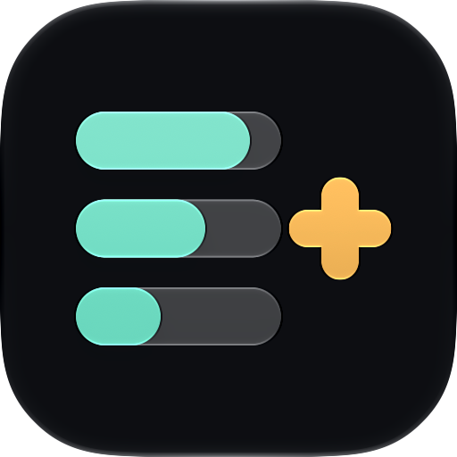
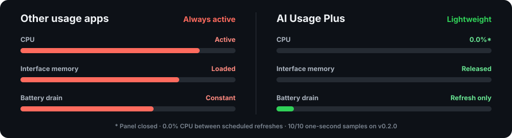

<p align="center">
  <picture>
    <source media="(prefers-color-scheme: dark)" srcset="docs/images/app-icon-dark.png">
    <source media="(prefers-color-scheme: light)" srcset="docs/images/app-icon-light.png">
    
  </picture>
</p>

<h1 align="center">AI Usage Plus</h1>

<p align="center">
  <strong>Your coding agents' limits, one click away.</strong><br>
  Native Liquid Glass. Measured at 0.0% CPU between scheduled refreshes.
</p>

<p align="center">
  
  
  <a href="LICENSE"></a>
</p>

<p align="center">
  
</p>

<p align="center">
  <sub>A real native menu bar popover — no Dock icon or persistent window.</sub>
</p>

> [!NOTE]
> AI Usage Plus is an independently maintained, open-source fork of
> [AI Usage](https://github.com/burakgon/ai-usage-menubar) by Burak Gon. It
> keeps the same goals and the same MIT license, and ships new providers and
> fixes on its own schedule. See [Differences from AI Usage](#differences-from-ai-usage).

AI Usage Plus shows Claude Code, Codex, Cursor, Antigravity, GitHub Copilot,
Devin, Grok, and DeepSeek limits and stays out of the way. No extra account, API key, local
server, telemetry, usage history, or background log scanning.

## Choose exactly what appears.

<p align="center">
  
</p>

<p align="center">
  <sub>Track every tool you use. Only selected providers and metrics reach the menu bar.</sub>
</p>

## Other usage apps stay heavy. AI Usage Plus stays light.

<p align="center">
  
</p>

## Install

### Homebrew (recommended)

```bash
brew install --cask rafalozan0/tap/ai-usage-plus
```

The app appears in the menu bar rather than the Dock. macOS 26 or newer is
required. Updates arrive in-app through Sparkle, so you don't need
`brew upgrade` for it.

### DMG

<p>
  <a href="https://github.com/rafalozan0/ai-usage-plus/releases/latest/download/AI-Usage-Plus.dmg">
    
  </a>
</p>

Open the DMG, drag **AI Usage Plus** to Applications, and launch it.

### Opening the app the first time

AI Usage Plus is free and open source, and it is not signed with a paid Apple
Developer ID or notarized by Apple. Homebrew handles this for you. If you
installed from the DMG, macOS blocks the first launch:

1. Open **AI Usage Plus** once and dismiss the warning.
2. Go to **System Settings → Privacy & Security**.
3. Scroll down and click **Open Anyway** next to the AI Usage Plus message,
   then confirm with your password.

You only need to do this once. Alternatively, run:

```bash
xattr -dr com.apple.quarantine "/Applications/AI Usage Plus.app"
```

> [!NOTE]
> Every release is signed with the same self-signed certificate, so when macOS
> asks whether AI Usage Plus can read a tool's Keychain item, **Always Allow**
> keeps working across updates. Updates are protected by Sparkle's EdDSA
> signature.

## Differences from AI Usage

AI Usage Plus 1.0.0 is based on AI Usage 0.2.1 and adds:

- Antigravity Argon quota pool tracking and the current CLI user agent
- A DeepSeek provider that shows your API balance as a bar from your starting
  balance down to zero
- A fix for provider cards overlapping the footer while scrolling
- A fix for the Grok icon looking thin and cut off
- An Edit menu so text fields accept paste

It uses its own bundle identifier (`com.rafalozan0.aiusageplus`), so it can be
installed next to the original. Useful fixes are still offered upstream as
pull requests.

## What you get

- Claude Code session, weekly, Sonnet, and Fable limits
- Codex session, weekly, Spark, and Spark weekly limits
- Cursor total, Auto, and API usage
- Antigravity Gemini, Claude, and Argon pool limits
- GitHub Copilot credits, chat, and completions
- Devin daily and weekly quota
- Grok weekly quota
- DeepSeek API balance
- Claude Code extra usage and Codex credits when available
- Remaining or used percentages, switchable directly in the panel
- Independent menu bar controls and metric choices for each provider
- Configurable 1, 5, 15, 30, or 60-minute refresh and one-click manual refresh
- Signed update checks at launch and daily, plus **Check for Updates…**
- A direct **Update** button in the panel when a new version is available
- Provider cards only for installed tools, with signed-out status kept visible
- Native light and dark appearances with Liquid Glass
- Launch at Login enabled by default and still user-controllable

## Build from source

You need:

- macOS 26 or newer
- Xcode 27 or newer

Then:

```bash
git clone https://github.com/rafalozan0/ai-usage-plus.git
cd ai-usage-plus
./scripts/install.sh
```

The script builds a local Release version, installs it to
`~/Applications/AI Usage Plus.app`, and opens it. AI Usage Plus appears in the
menu bar, not the Dock.

To run without the installer, open `AIUsage.xcodeproj` in Xcode and run the
`AIUsage` scheme.

## How it works

AI Usage Plus reuses credentials already created by supported tools, then requests
quota data directly from each provider's first-party endpoint.

- Credentials stay on your Mac.
- Tokens are never printed, logged, or sent anywhere else.
- Temporary failures keep the last successful values in memory and mark them
  stale.
- Nothing is cached across launches.

API-key-only Codex authentication can't read ChatGPT subscription usage.
`CLAUDE_CODE_OAUTH_TOKEN` is intentionally ignored because setup tokens don't
include the profile scope required by Claude's usage endpoint.

The exact researched contracts are documented in
[docs/provider-contracts.md](docs/provider-contracts.md).

## Menu bar behavior

Every provider can be shown or hidden independently. Under each provider,
choose any metric it currently returns. A single metric shows only its value;
multiple metrics use tiny labels to stay compact. **Weekly** is selected for
Claude Code and Codex by default, and **Left** is the default number mode.

Raw percentages are shown exactly as reported by the provider. Only progress
bar drawing is clamped to `0...100`. Remaining usage is bounded to `0...100`
because a negative remaining percentage is not meaningful.

## Development

Run the complete test suite:

```bash
xcodebuild test \
  -project AIUsage.xcodeproj \
  -scheme AIUsage \
  -destination 'platform=macOS'
```

The app is SwiftUI and AppKit, with a small provider layer and an in-memory
store. Its only runtime package dependency is
[Sparkle](https://github.com/sparkle-project/Sparkle), used for signed
over-the-air updates.

Contributions are welcome. Please read [CONTRIBUTING.md](CONTRIBUTING.md)
before opening a pull request.

Adaptive icon previews can be regenerated with
`./scripts/generate_app_icon.swift`.

Release packaging and OTA feed maintenance are documented in
[docs/releasing.md](docs/releasing.md).

## Upstream research

AI Usage Plus is a fork of
[burakgon/ai-usage-menubar](https://github.com/burakgon/ai-usage-menubar).
Provider contracts and parts of the system-boundary implementation were
adapted from [OpenUsage](https://github.com/robinebers/openusage), using stable
tag `v0.7.6` and provider updates through commit
`9d2bf09f10e21f769494a525a9d65c84d7aeb1df`.
See [NOTICE](NOTICE) for attribution.

## License

AI Usage Plus is available under the [MIT License](LICENSE), like the
original AI Usage.

---

If AI Usage Plus saves you a few clicks, please
[star the repository](https://github.com/rafalozan0/ai-usage-plus). It helps
other coding-agent users find it.
