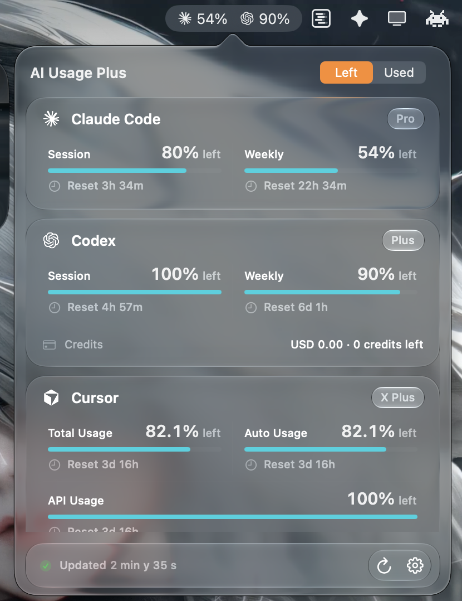
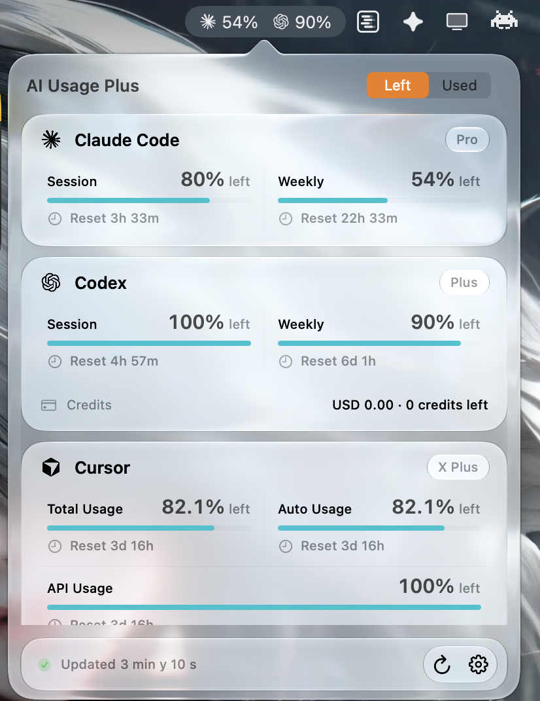

<p align="center">
  <picture>
    <source media="(prefers-color-scheme: dark)" srcset="docs/images/app-icon-dark.png">
    <source media="(prefers-color-scheme: light)" srcset="docs/images/app-icon-light.png">
    
  </picture>
</p>

<h1 align="center">AI Usage Plus</h1>

<p align="center">
  <strong>Every coding agent's limits, one click away in your menu bar.</strong><br>
  Native Liquid Glass. Measured at 0.0% CPU between scheduled refreshes.
</p>

<p align="center">
  <a href="https://github.com/rafalozan0/ai-usage-plus/releases/latest"></a>
  
  
  <a href="LICENSE"></a>
</p>

<table align="center">
  <tr>
    <td></td>
    <td></td>
  </tr>
</table>

<p align="center">
  <sub>A real native menu bar popover in light and dark mode. No Dock icon, no persistent window.</sub>
</p>

AI Usage Plus shows how much is left on Claude Code, Codex, Cursor,
Antigravity, GitHub Copilot, Devin, Grok, and DeepSeek, then gets out of the
way. No extra account, local server, telemetry, usage history, or background
log scanning.

> [!NOTE]
> AI Usage Plus is an independently maintained, open-source fork of
> [AI Usage](https://github.com/burakgon/ai-usage-menubar) by Burak Gon. It
> keeps the same goals and the same MIT license, and ships new providers and
> fixes on its own schedule. See [What's different](#whats-different).

## Install

### Homebrew (recommended)

```bash
brew install --cask rafalozan0/tap/ai-usage-plus
```

The app appears in the menu bar rather than the Dock. macOS 26 or newer is
required. Updates arrive in-app through Sparkle, so you don't need
`brew upgrade` for it.

### DMG

<p>
  <a href="https://github.com/rafalozan0/ai-usage-plus/releases/latest/download/AI-Usage-Plus.dmg">
    
  </a>
</p>

Open the DMG, drag **AI Usage Plus** to Applications, and launch it.

### Opening the app the first time

AI Usage Plus is free and open source, and it is not signed with a paid Apple
Developer ID or notarized by Apple. Homebrew handles this for you. If you
installed from the DMG, macOS blocks the first launch:

1. Open **AI Usage Plus** once and dismiss the warning.
2. Go to **System Settings → Privacy & Security**.
3. Scroll down and click **Open Anyway** next to the AI Usage Plus message,
   then confirm with your password.

You only need to do this once. Alternatively, run:

```bash
xattr -dr com.apple.quarantine "/Applications/AI Usage Plus.app"
```

> [!NOTE]
> Every release is signed with the same self-signed certificate, so when macOS
> asks whether AI Usage Plus can read a tool's Keychain item, **Always Allow**
> keeps working across updates. Updates are protected by Sparkle's EdDSA
> signature.

## Supported providers

| Provider | Signs in with | What you see |
|---|---|---|
| Claude Code | Claude Code login | Session, weekly, Sonnet, and Fable limits; extra usage |
| Codex | Codex login | Session, weekly, Spark, and Spark weekly limits; credits |
| Cursor | Cursor app login | Total, Auto, and API usage; X Subscription pool |
| Antigravity | Antigravity login | Session and weekly limits; Claude and Argon pools |
| GitHub Copilot | Copilot or GitHub CLI login | Credits, chat, and completions |
| Devin | Devin CLI login | Daily and weekly quota |
| Grok | `grok login` | Weekly quota, or the shared X Subscription pool |
| DeepSeek | API key pasted in Settings | API balance |

Cards appear only for tools installed on your Mac. Signed-out tools stay visible
with a short explanation.

### The X Subscription (Grok + Cursor)

Since October 2026, xAI sells Grok and Cursor together as The X Subscription,
with one weekly usage pool shared by Grok, Grok Build, and Cursor's Grok and
Composer models. AI Usage Plus detects merged accounts:

- The Cursor card shows your tier as **X Plus**, **X Premium**, and so on, and
  notes that the pool is shared with Grok.
- xAI's own Grok billing endpoint fails for merged accounts, so the Grok card
  shows the same shared pool, read through your Cursor login.

Third-party models in Cursor, such as Claude or GPT, are billed outside the
pool and show up as Cursor's **API Usage**.

## What you get

- Remaining or used percentages, switchable directly in the panel
- Independent menu bar controls and metric choices for each provider
- Configurable 1, 5, 15, 30, or 60-minute refresh and one-click manual refresh
- Signed update checks at launch and daily, plus **Check for Updates…**
- A direct **Update** button in the panel when a new version is available
- Native light and dark appearances with Liquid Glass
- Launch at Login enabled by default and still user-controllable

## Other usage apps stay heavy. AI Usage Plus stays light.

<p align="center">
  
</p>

## What's different

AI Usage Plus started from AI Usage 0.2.1 and adds:

- **The X Subscription:** shared Grok + Cursor pool, labeled on both cards
- **DeepSeek:** API balance shown as a bar from your starting balance to zero
- **Antigravity Argon:** the Argon weekly pool and the current CLI user agent
- **Fixes:** provider cards no longer overlap the footer while scrolling, the
  Grok icon is no longer thin and cut off, and text fields accept paste
- **Its own identity:** new icon, bundle identifier
  `com.rafalozan0.aiusageplus`, update feed, and Homebrew tap, so it installs
  next to the original

Useful fixes are still offered upstream as pull requests.

## How it works

AI Usage Plus reuses credentials already created by supported tools, then
requests quota data directly from each provider's first-party endpoint.

- Credentials stay on your Mac.
- Tokens are never printed, logged, or sent anywhere else.
- Temporary failures keep the last successful values in memory and mark them
  stale.
- Nothing is cached across launches.

API-key-only Codex authentication can't read ChatGPT subscription usage.
`CLAUDE_CODE_OAUTH_TOKEN` is intentionally ignored because setup tokens don't
include the profile scope required by Claude's usage endpoint.

The exact researched contracts are documented in
[docs/provider-contracts.md](docs/provider-contracts.md).

## Menu bar behavior

Every provider can be shown or hidden independently. Under each provider,
choose any metric it currently returns. A single metric shows only its value;
multiple metrics use tiny labels to stay compact. **Weekly** is selected for
Claude Code and Codex by default, and **Left** is the default number mode.

Raw percentages are shown exactly as reported by the provider. Only progress
bar drawing is clamped to `0...100`. Remaining usage is bounded to `0...100`
because a negative remaining percentage is not meaningful.

## Build from source

You need macOS 26 or newer and Xcode 27 or newer. Then:

```bash
git clone https://github.com/rafalozan0/ai-usage-plus.git
cd ai-usage-plus
./scripts/install.sh
```

The script builds a local Release version, installs it to
`~/Applications/AI Usage Plus.app`, and opens it. To run without the installer,
open `AIUsage.xcodeproj` in Xcode and run the `AIUsage` scheme.

## Development

Run the complete test suite:

```bash
xcodebuild test \
  -project AIUsage.xcodeproj \
  -scheme AIUsage \
  -destination 'platform=macOS'
```

The app is SwiftUI and AppKit, with a small provider layer and an in-memory
store. Its only runtime package dependency is
[Sparkle](https://github.com/sparkle-project/Sparkle), used for signed
over-the-air updates.

Contributions are welcome. Please read [CONTRIBUTING.md](CONTRIBUTING.md)
before opening a pull request. Releases are built by GitHub Actions from a
`v*` tag, as described in [docs/releasing.md](docs/releasing.md). The app icon
previews can be regenerated with `./scripts/generate_app_icon.swift`.

## Credits

AI Usage Plus is a fork of
[burakgon/ai-usage-menubar](https://github.com/burakgon/ai-usage-menubar) by
Burak Gon. Provider contracts and parts of the system-boundary implementation
were adapted from [OpenUsage](https://github.com/robinebers/openusage), using
stable tag `v0.7.6` and provider updates through commit
`9d2bf09f10e21f769494a525a9d65c84d7aeb1df`. See [NOTICE](NOTICE) for
attribution.

Provider names and logos identify their respective services and do not imply
endorsement.

## License

AI Usage Plus is available under the [MIT License](LICENSE), like the original
AI Usage.

---

If AI Usage Plus saves you a few clicks, please
[star the repository](https://github.com/rafalozan0/ai-usage-plus). It helps
other coding-agent users find it.
